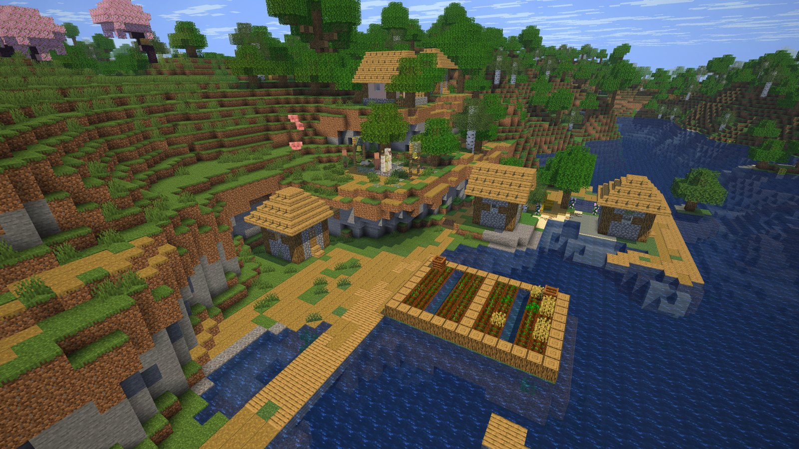
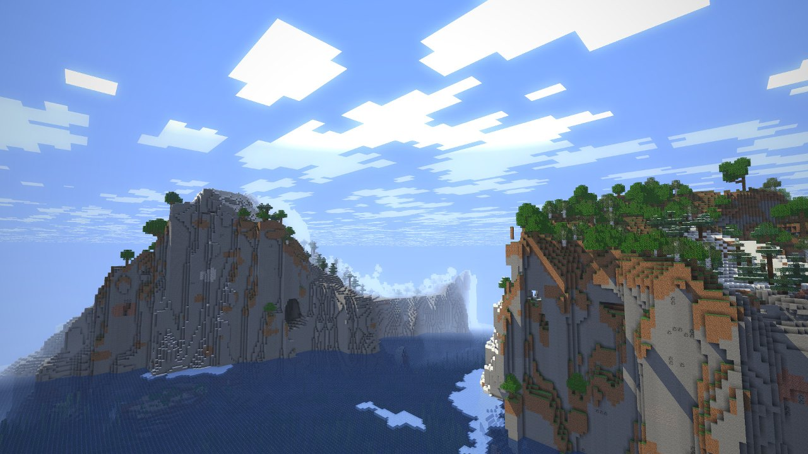
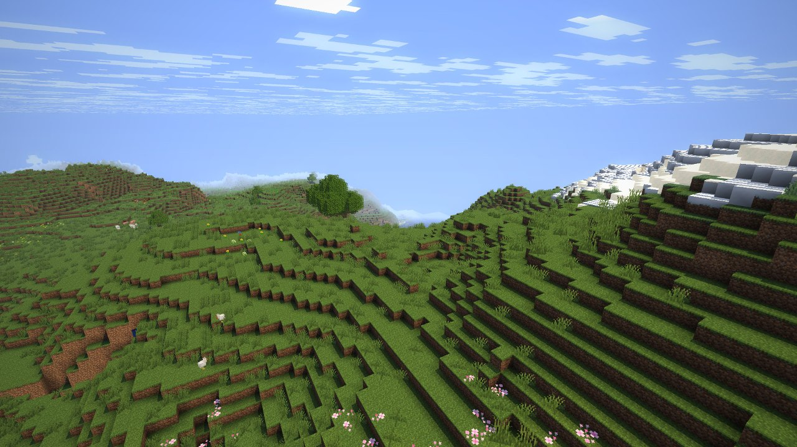
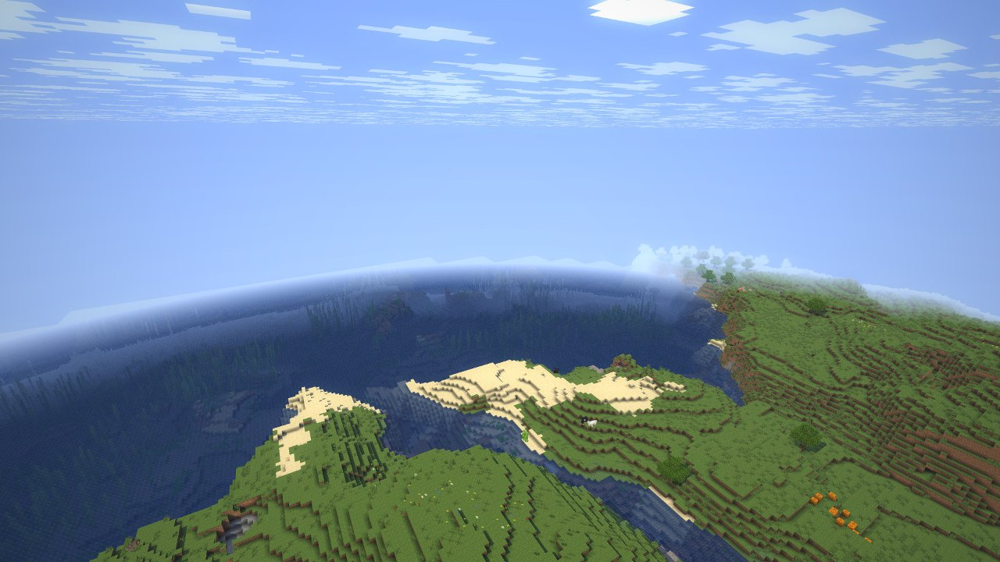

# Postcards

**A daily photo of your Minecraft world, posted to Discord.** Players place virtual cameras with
`/postcard set`. Every day the server renders what each camera sees and sends the picture to a webhook.

- **Server-side only:** no bot account joins and players don't need any mods. Vanilla clients work.
  An optional client helper places cameras with [Freecam and the player's own FOV](docs/usage.md#client-helper-freecam-and-your-field-of-view).
- **Real 3D renders**, made on the server by a renderer based on [Camera Obscura](https://github.com/tomalbrc/camera-obscura): 1920×1080,
  16 chunks of view distance, with a choice of two built-in shaders: a light one with sun shadows, or a
  [realistic one](docs/shader.md#realistic) with a physical sky, soft shadows and water reflections.
- **Distant terrain** out to 64 chunks, like Voxy: far hills, coasts and mountains from the saved world.
- **One camera per player**, named after them. Staff can add named cameras.
- **Gentle on the server:** renders run in the background and give way to the game. TPS stays at 20 even on a
  2-core host ([measurements](docs/performance.md)).
- **Discord-ready:** an embed with the picture, the camera name, coordinates and owner.

| | | |
|---|---|---|
|  |  |  |

## Quick start

1. Download `postcards-<version>.jar` from the [releases](https://github.com/kunaigear/mc-postcards/releases)
   and put it in your server's `mods/` folder together with:

   | Mod | Version |
   |---|---|
   | [Fabric API](https://modrinth.com/mod/fabric-api) | 0.166.2+26.3 or newer |
   | [Polymer](https://modrinth.com/mod/polymer) | 0.18.x+26.3 |

   You need Minecraft 26.3, Fabric Loader 0.19.5 or newer, and Java 25.
2. Start the server once. It creates `config/postcards/config.json`.
3. [Create a Discord webhook](docs/configuration.md#discord-webhook), put its URL in `webhookUrl`, and run
   `/postcard reload`.
4. In game, look at something nice and run `/postcard set`. Click **[Preview now]** to get the first picture
   straight away. After that, one arrives every day at 12:00 (configurable).

## Documentation

| | |
|---|---|
| [Cameras, commands and permissions](docs/usage.md) | Personal and named cameras, every command, permission tiers and LuckPerms nodes. |
| [Configuration](docs/configuration.md) | Discord setup, schedule, picture size, every `config.json` option. |
| [Shaders](docs/shader.md) | The simple and realistic shaders, with pictures, settings and cost. |
| [Distant terrain](docs/distant-terrain.md) | Voxy-style terrain out to 64 chunks, from the saved world. |
| [Performance](docs/performance.md) | How rendering stays out of the server's way, with measurements. |
| [Compatibility](docs/compatibility.md) | Tested mods (Lithium, C2ME, ScalableLux, Jade, JEI, Voxy…) and what players need. |
| [Development](docs/development.md) | Building, test servers and making a release. |

## Good to know

- **Pictures show what the renderer can read:** vanilla models and textures, lighting, fog, sky and clouds.
  Modded blocks appear only if their models are in Polymer's resource pack.
- **Webhook URLs are secrets.** Commands only show a shortened form. Anyone who can read
  `config/postcards/` can see the full URLs.

## License

Copyright (c) 2026 kunaigear. Postcards, including the client helper, is licensed under the
[GNU Affero General Public License, version 3](LICENSE). The renderer in
`src/main/java/io/github/kunaigear/postcards/obscura/` is a modified copy of
[Camera Obscura](https://github.com/tomalbrc/camera-obscura) by tomalbrc, under the same license. Each of those files
says so.
