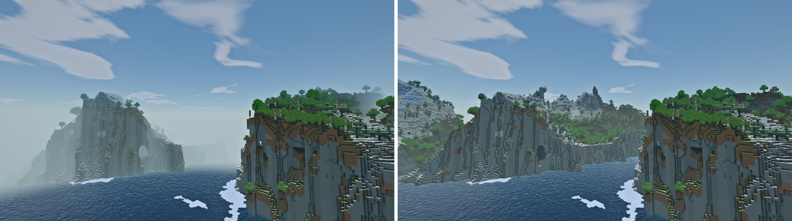

# Distant terrain

[← Back to the README](../README.md)

Beyond the normal render distance (16 chunks), Daily Cams keeps drawing the world's real blocks, the way Voxy does
in game. By default it reaches 64 chunks (1024 blocks).

## How it works

It works the way Voxy does, on the server:

- **Real blocks from the saved world.** The server has already saved every chunk that was ever explored. Daily
  Cams reads the saved chunks in the camera's view directly from disk, without loading them into the world, and
  keeps their blocks around the surface, with the sky and block light saved for each block.
- **Baked block models.** Each block's model, the same one Camera Obscura draws up close, is drawn from each of its
  six sides into a small 16x16 picture. Distant blocks show those pictures: their real textures, overlays like the
  grass on a grass block's side, and their shapes, so leaves and plants are partly see-through. Grass, leaves and
  water get their biome colours. Further away, the pictures are averaged down so textures don't flicker.
- **Traced, not meshed.** Wherever the picture would show sky, rays go through the distant blocks: they skip empty
  air quickly, then walk block by block near the surface, through water down to the ground beneath. Every
  supersample gets its own ray, so edges are as smooth as the near terrain's.
- **Lit like the near terrain.** Distant blocks use their saved light (dark under trees and overhangs, lit around
  torches at night), the same corner shading as vanilla, and the same lighting as the blocks up close: with the
  [realistic shader](shader.md#realistic), sun shadows traced through the distant blocks, sky light, water with
  reflections and haze; with the simple shader, Camera Obscura's own shading with the simple shader's shadows.
- **Distance fog.** Distant terrain fades gently into the haze over its last half, so the end of the world isn't
  a hard line.

Only explored terrain appears: terrain that was never generated stays sky or haze. Daily Cams doesn't generate it,
since that would cost the server as much as a player exploring it.

Distant terrain is off in dimensions with a roof (the Nether).

## Setting

| Key | Default | Effect |
|---|---|---|
| `lodDistance` | `64` | How far distant terrain reaches, in chunks (17–128, must be more than `renderDistance`). `0` turns it off. |

Run `/dailycam reload` after changing it.

## Cost

Reading the saved chunks takes a few seconds per camera: on the 2-core test host, about 6 s for about 4,300 chunks
at the default 64 chunks. Reads go through the server's own chunk storage, a few at a time, and pause while the
server is busy. Drawing the distant blocks adds a few more seconds to the shader. In that test, TPS stayed at 20,
the longest server tick while reading or shading was 12 ms, and memory use didn't change noticeably. Twice the
distance means roughly four times as many chunks to read.
