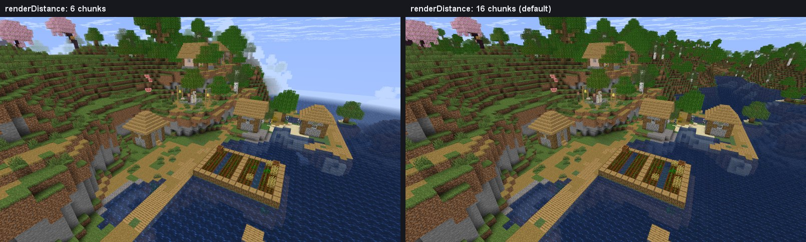

# Performance

[← Back to the README](../README.md)

Rendering a picture is real work: the server loads the area around the camera, builds 3D geometry for it and draws
it in software. Daily Cams does all of that in the background and gives way to the game whenever the server is
busy. Renders take longer on a small server, but players shouldn't notice them.

## How a render works

1. At each scheduled time, all cameras are queued and rendered one at a time.
2. For each camera, the mod works out which chunks it can actually see (its view cone, up to `renderDistance`),
   plus a one-chunk margin. It loads them with temporary chunk tickets, nearest first and a few at a time. The
   tickets aren't saved and don't tick entities. Missing terrain is generated as it would be for a player.
3. A background thread builds geometry for the visible chunk sections, draws the frame with Camera Obscura, applies
   the [shader](shader.md) and encodes the image.
4. The tickets are removed and the picture is uploaded. HTTP 429 and 5xx responses are retried, and Discord's
   `retry_after` is respected.

A dedicated server stops ticking after it's been empty for a while (`pause-when-empty-seconds`). The schedule runs
on a wall-clock timer, so it still fires on an empty, paused server, and the mod keeps the server awake until the
queue is done.

## Staying out of the way

- **CPU budget:** the render thread uses at most `renderCpuShare` of one core (default 25%). It works in slices of a
  few milliseconds and sleeps in between, while building geometry, drawing and shading.
- **Backing off:** if a server tick takes longer than 25 ms, or starts more than 30 ms late (for example because of
  garbage collection or world generation), the render and the chunk loader pause for a second.
- **Gradual chunk loading:** at most 4 chunk requests are outstanding at once, and new ones are only made while the
  server keeps up. While it's busy, one chunk per second is still requested, so a permanently busy server finishes
  eventually.

## Measurements

These come from an emulated small host: 2 CPU cores, 3 GB heap and 200 mobs in force-loaded chunks. Each test
rendered one camera over already-generated terrain and one over new terrain. A hitch is a tick that started more
than 100 ms after the one before it (two ticks' worth), which players can notice.

| | Hitches | Worst second | Longest GC pause | Time per camera |
|---|---|---|---|---|
| Idle server | 4 per minute | 19 TPS | – | – |
| Without throttling | 42 per minute | 6 TPS | 122 ms | 15–20 s |
| With throttling, 720p PNG | 6–7 per minute | 17–19 TPS | 42–75 ms | 50–90 s |
| **With throttling, 1080p JPEG (default)** | **5 per minute** | **19–20 TPS** | **61 ms** | **53–95 s** |
| Same, plus Lithium, C2ME, ScalableLux and others | 8 per minute | 18–20 TPS | 75 ms | 36–58 s |

- Both throttled rows were measured with the shader on. The hitch difference between them is within run-to-run
  noise.
- The remaining hitches mostly come from generating new terrain. That only happens the first time a camera renders
  an area, and it costs the same as a player exploring it. On later days the chunks load from disk.
- Renders finish faster with more cores, a higher `renderCpuShare`, or C2ME (which loads and generates chunks
  faster).
- Each render logs how long it spent building, drawing and shading, and how long it waited for the server.

### Shaders

The same host and mobs, with the default settings (distant terrain out to 64 chunks, 1080p JPEG), rendering the
village from [the documentation pictures](development.md#documentation-pictures) four times with each shader, over
terrain that was already generated. Half of the renders started with an empty
[distant terrain cache](distant-terrain.md#cache), the other half found the chunks of the render before in it:

| Shader | Time per camera | With the distant terrain cached | Of that, shading | Worst second |
|---|---|---|---|---|
| `none` | 41–45 s | 32–34 s | 1–1.5 s | 18–20 TPS |
| `simple` | 43–45 s | 34–35 s | 2.5 s | 19–20 TPS |
| `realistic` | 63–68 s | 54–55 s | 18–21 s | 18–20 TPS |

Building geometry for the chunks in view takes 15–18 s, drawing the frame 15–19 s (the realistic shader's leaves,
which stick out of their blocks, add about 4 s), and reading the distant terrain about 10 s from disk or 1 s from the
cache. There was about one hitch per render, each from a garbage collection pause of 55–105 ms: the render makes as
much garbage as it always did, but in less time, so the collector has more to copy at once. The idle server had no
hitches.

### Weaker hosts

These come from the [render benchmark](development.md#render-benchmark) on a 6-core desktop. It renders the village
and peaks cameras with each shader, six renders in all, next to 200 cows. The idle server had no hitches in any of
these setups. A core count only tells the JVM how many cores to plan for, with `-XX:ActiveProcessorCount`. A quota
takes CPU time away through a cgroup, the way a small VPS or a container limit does.

| Limits | Collector | Six renders | Hitches | Worst second | Longest tick | Longest GC pause |
|---|---|---|---|---|---|---|
| 4 cores | G1 | 331 s | 1 | 19 TPS | 58 ms | 81 ms |
| 2 cores (two runs) | G1 | 330–337 s | 2–3 | 19 TPS | 88–96 ms | 78–531 ms |
| 2 cores, 2 GB heap | G1 | 306 s | 5 | 19 TPS | 82 ms | 78 ms |
| 1 core | Serial | 359 s | 12 | 15 TPS | 202 ms | 473 ms |
| Quota of 2 cores | G1 | 323 s | 8 | 20 TPS | 220 ms | 90 ms |
| Quota of 1 core | Serial | 354 s | 8 | 19 TPS | 449 ms | 444 ms |
| Quota of half a core | Serial | 511 s | 47 | 3 TPS | 303 ms | 1167 ms |

- Down to one core, a render takes about as long as with four: the render thread's `renderCpuShare` of one core sets
  the pace, not the cores. With half a core, that share is half of all the CPU there is.
- The worst hitches come from garbage collection. The server allocates about 40 MB/s with just the cows and about
  155 MB/s while rendering. That is about 480 MB for every second of CPU time the render thread gets, and the
  throttle only counts CPU time. With one CPU the JVM picks the Serial collector, which stops the server for every
  collection. In those runs the realistic renders filled the old generation and caused a full collection of
  0.4–1.2 s, and the young collections after it took 130–270 ms.
- A real quota hurts more than fewer cores. The collector's threads, the render thread and the server share one
  budget per 100 ms. When it runs out, every thread waits for the next period, even in the middle of a tick.

## Render distance

`renderDistance` is in chunks, like Minecraft's own setting. The default of 16 (256 blocks) shows the landscape
around a scene instead of a wall of fog:

Most of a render's time goes into building geometry for the chunks in view and drawing it, so the cost grows with
`renderDistance`. Values up to 32 are accepted, but expect roughly 4× the work of 16. Resolution matters much less:
going from 720p to 1080p made a render about 6% slower.
