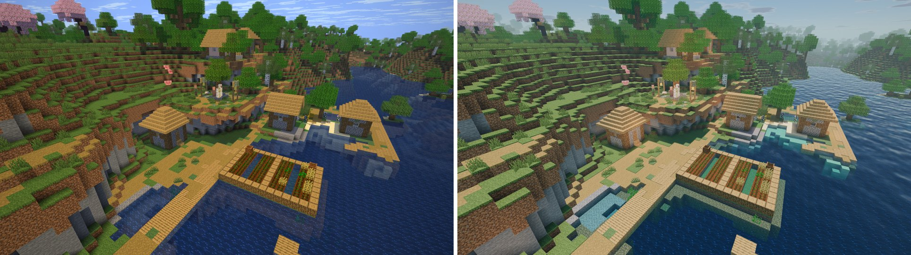
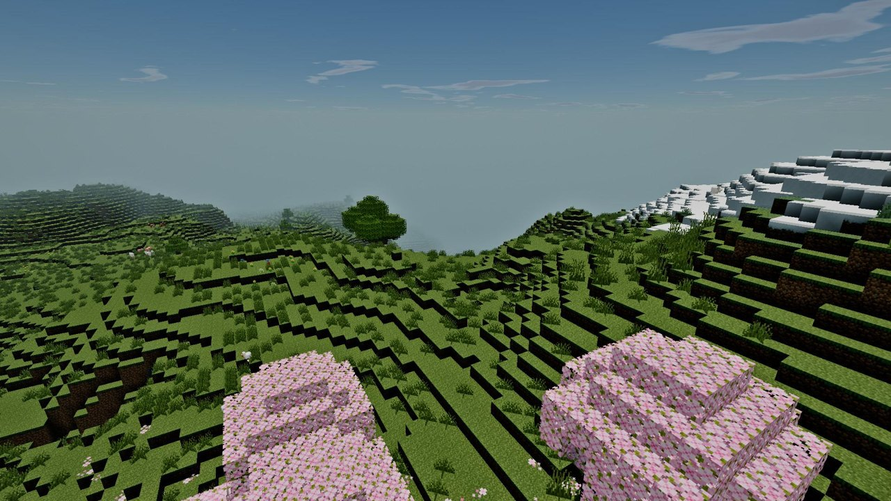
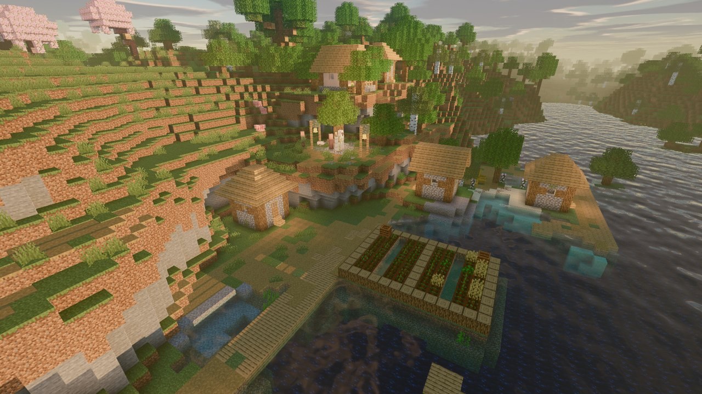
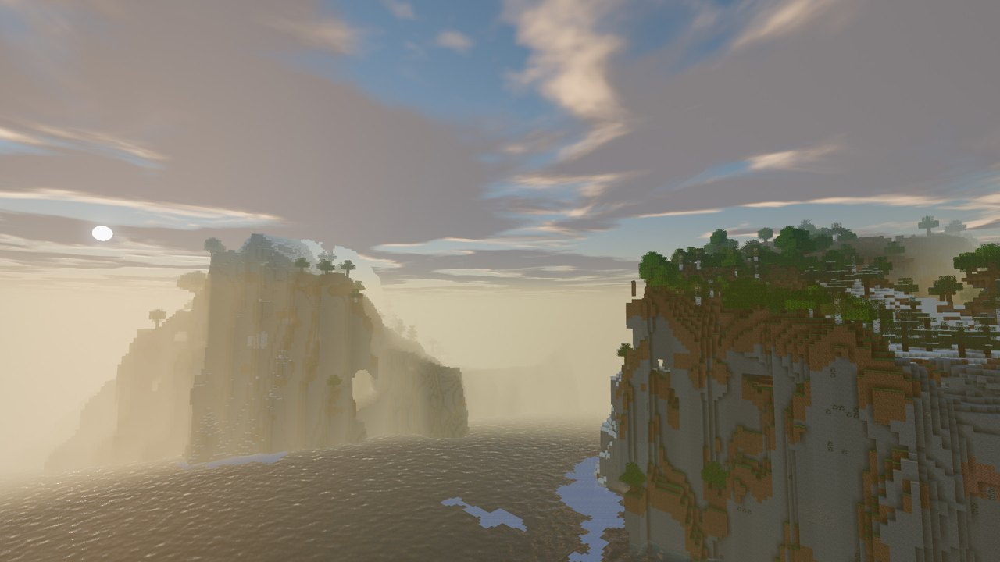
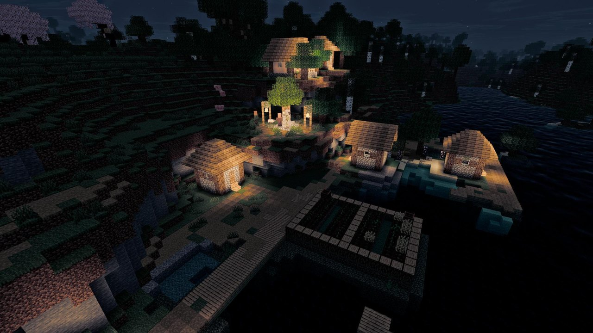
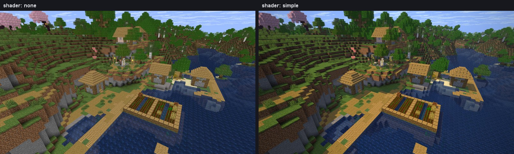

# Shaders

[← Back to the README](../README.md)

Daily Cams has two built-in "shader packs". They run on the server after Camera Obscura has drawn the picture, so
players don't need anything for them. They're unrelated to Iris shader packs on players' clients.

| `"shader"` | Look | Extra time per camera (1080p, 2-core host) |
|---|---|---|
| `simple` (default) | Camera Obscura's picture with sun shadows, warm light, haze, bloom and a colour grade. | about 6 s |
| `realistic` | Relit from scratch, in the style of shader packs like Photon: physical sky, volumetric clouds, soft shadows, sun rays, leaves that glow in the sun, reflections in water, filmic colour. | about 24 s |
| `none` | Camera Obscura's plain picture. | – |

Choose one for every camera with `"shader"` in the config, or for one camera with
`/dailycam shader <simple|realistic|none> [name]`. `default` makes a camera follow the config again.

## Realistic

Instead of adjusting Camera Obscura's picture, the realistic shader records what each pixel shows (the block's
colour without lighting, its direction, and the sky and block light there) while the picture is drawn. It then
lights the scene again from scratch:

- **A physically based sky.** Sunlight is scattered by the air (blue sky), by haze (the bright glow around the
  sun) and absorbed by an ozone layer (the deep blue at dusk), in an Earth-sized atmosphere. Sunrise and sunset
  colour the sky, the sunlight and everything it lights.
- **Volumetric clouds.** Cumulus clouds between y 900 and 1500, with flat bases and rounded tops, ray marched
  through the layer. Light from the sun is followed through each cloud, so they're bright where the sun hits them,
  grey underneath, and get a silver edge when you look towards the sun. They change from day to day and with the
  weather, and cast soft shadows on the land when the sun is high.
- **Sunlight and shadows.** Rays are traced through the world's blocks towards the sun (or the moon at night).
  Shadow edges are softened, and leaves let some light through, so tree shadows are dappled.
- **Leaves and plants.** Leaves stick out of their blocks, so trees have a ragged outline instead of cubes. A leaf
  block is lit like a cloud of small leaves rather than a solid cube: bright wherever the sun reaches it, darker
  deeper in the canopy. Looking towards the sun, light shines through the leaves, so the
  edges of canopies glow green. Up close, each cluster of leaves in the texture has a little relief and a soft
  sheen. Grass, flowers and crops are lit like the ground they grow on.
- **Sky light** with the actual colour of the sky, weakened in shade, under overhangs and in corners. Ambient
  occlusion, worked out from the picture, darkens canopy interiors, plants and the ground under trees. Torches,
  lanterns and other light sources give off warm light, and glow.
- **Water** reflects what's around it: trees, hills and distant terrain that are in the picture, and the sky and
  clouds where the reflection leaves the picture. Gentle waves break up the reflections near the camera and calm
  down further away. It gets darker and bluer the deeper it is, and the ground in shallow water shows caustics,
  the bright lines of sunlight focused by the waves.
- **Sun rays.** Looking towards a low sun, light streams through gaps in trees, terrain and clouds.
- **Distance haze** that matches the sky, and the edge of the loaded world fades into it. Distant textures are
  averaged like mipmaps, so far-away grass and leaves don't sparkle.
- **Exposure and colour like a camera.** The picture is computed in high dynamic range and exposed automatically
  for the land (the sky stays bright, sunsets don't blow out), then tone mapped with AgX, a filmic curve that keeps
  bright colours from clipping. A little bloom, a slight vignette and some sharpening.

Nights are dark, but not pitch black: the exposure brightens dark scenes a little (up to `maxExposure`), a little
light is always there (`minLight`), and dim areas shift towards night vision: bluer and less colourful. The moon
lights the land and the stars are out. Torches and lanterns light warm pools around them; the exposure is capped
so they never white out.

| | |
|---|---|
|  |  |
|  |  |

### Settings

The realistic shader is tuned with `realisticSettings`:

| Key | Default | Range | Effect |
|---|---|---|---|
| `exposure` | `1.0` | 0.1–10 | Brightness on top of the automatic exposure. |
| `maxExposure` | `14` | 1–200 | How far dark scenes (night, caves) may be brightened. Higher = brighter nights. |
| `minLight` | `0.006` | 0–0.5 | Light that's always there, so places without any light aren't pitch black. |
| `haze` | `1.0` | 0–5 | Haze over distant terrain. |
| `clouds` | `1.0` | 0–2 | Cloud cover: 0 = always clear, 1 = varies from day to day, 2 = mostly cloudy. Rain adds clouds either way. |
| `shadowSoftness` | `1.0` | 0–4 | Width of shadow edges (0 = hard). |
| `bloom` | `0.08` | 0–1 | Glow around the sun and light sources. |
| `saturation` | `1.2` | 0–2 | Colour intensity. |
| `contrast` | `1.25` | 0.5–2 | Filmic contrast (1 = neutral). |
| `clarity` | `0.3` | 0–1 | Local contrast: brings out detail and makes surfaces stand out from their surroundings. |
| `vignette` | `0.12` | 0–1 | Darkening towards the corners. |
| `waterReflections` | `1.0` | 0–2 | Strength of reflections on water (1 = physically based). |
| `sunRays` | `1.0` | 0–3 | Strength of the sun rays (0 = off). |
| `sharpness` | `0.35` | 0–1 | Sharpening of the finished picture (0 = off). |

### Cost

On the 2-core test host, the realistic shader took 16 s for a 1080p picture, against 6 s for the simple one, under
the same CPU limit as the rest of the render. TPS stayed at 20 and no tick took longer than 25 ms. The clouds,
reflections and sun rays added since make it about a third slower, and the foliage lighting about 8% more (4.9 s,
then 6.5 s, then about 7 s for the same 1080p view on a desktop CPU without a limit). The leaves sticking out of
their blocks make drawing the frame about 1 s slower on that CPU (2.3 s to 3–3.8 s). Expect about 24 s on the test
host. It needs about 170 MB of extra memory at 1080p, and about 4× that at 4K.

The realistic shader replaces Camera Obscura's sky, clouds and fog with its own.

## Simple

- **Sun shadows.** Each pixel's position in the world is reconstructed from the depth buffer, and a ray is traced
  towards the sun through the world's blocks. Opaque blocks and leaves cast shadows. They're scaled by the sky light
  at that spot, so caves and interiors aren't darkened twice. Shadows fade out as the sun sets, and there are none
  at night.
- **Light colour.** Sunlit surfaces get a warm tint and shadows a cool, slightly blue one.
- **Haze.** Distant terrain fades a little towards the sky colour.
- **Bloom.** Bright areas, such as the sky near the sun, get a soft glow.
- **Grading.** A light contrast and saturation boost and a vignette.

The sun's position is the same one the game uses for its sky, so shadows point the way you'd expect for the time
of day.

### Settings

The simple shader is tuned with `shaderSettings`:

| Key | Default | Range | Effect |
|---|---|---|---|
| `shadowStrength` | `0.42` | 0–1 | How dark sun shadows get (1 = black). |
| `sunWarmth` | `0.10` | 0–0.5 | Warm tint on sunlit surfaces. |
| `haze` | `0.18` | 0–1 | How much distant terrain fades towards the sky. |
| `bloom` | `0.22` | 0–2 | Glow around bright areas. |
| `saturation` | `1.12` | 0–2 | Colour intensity (1 = unchanged). |
| `contrast` | `1.06` | 0.5–2 | Contrast (1 = unchanged). |
| `vignette` | `0.22` | 0–1 | Darkening towards the corners. |

### Cost

The simple shader adds 1–9 seconds per camera, depending on resolution and CPU. It runs in the background under
the same CPU limit as the rest of the render, and in the [2-core test](performance.md) the shading phase caused no
hitches.
