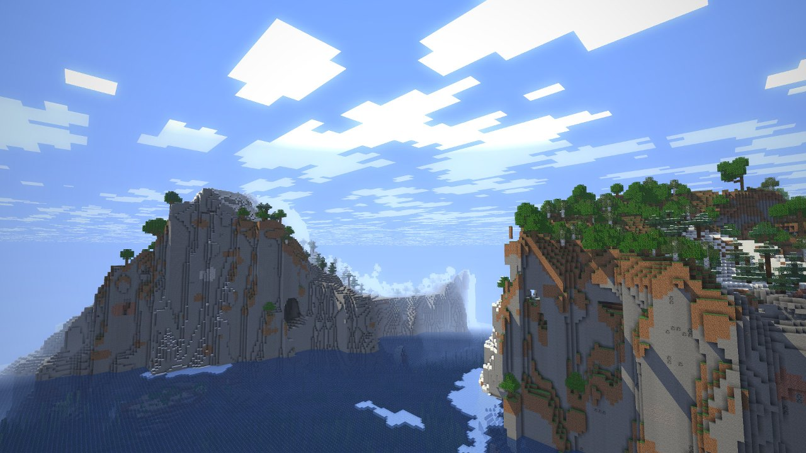

# Shader

[← Back to the README](../README.md)

Daily Cams has a small built-in "shader pack". It runs on the server after Camera Obscura has drawn the picture,
and it's on by default (`"shader": "simple"`).

- **Sun shadows.** Each pixel's position in the world is reconstructed from the depth buffer, and a ray is traced
  towards the sun through the world's blocks. Opaque blocks and leaves cast shadows. They're scaled by the sky light
  at that spot, so caves and interiors aren't darkened twice. Shadows fade out as the sun sets, and there are none
  at night.
- **Light colour.** Sunlit surfaces get a warm tint and shadows a cool, slightly blue one.
- **Haze.** Distant terrain fades a little towards the sky colour.
- **Bloom.** Bright areas, such as the sky near the sun, get a soft glow.
- **Grading.** A light contrast and saturation boost and a vignette.

The sun's position is the same one the game uses for its sky, so shadows point the way you'd expect for the time
of day.

## Turning it off

- For every camera: `"shader": "none"` in the config.
- For one camera: `/mc_camera shader none [name]`. Use `default` to follow the config again.

## Settings

Each effect can be tuned in `shaderSettings`:

| Key | Default | Range | Effect |
|---|---|---|---|
| `shadowStrength` | `0.42` | 0–1 | How dark sun shadows get (1 = black). |
| `sunWarmth` | `0.10` | 0–0.5 | Warm tint on sunlit surfaces. |
| `haze` | `0.18` | 0–1 | How much distant terrain fades towards the sky. |
| `bloom` | `0.22` | 0–2 | Glow around bright areas. |
| `saturation` | `1.12` | 0–2 | Colour intensity (1 = unchanged). |
| `contrast` | `1.06` | 0.5–2 | Contrast (1 = unchanged). |
| `vignette` | `0.22` | 0–1 | Darkening towards the corners. |

## Cost

The shader adds 1–9 seconds per camera, depending on resolution and CPU. It runs in the background under the same
CPU limit as the rest of the render, and in the [2-core test](performance.md) the shading phase caused no hitches.

This is unrelated to Iris shader packs on players' clients. Players don't need anything for it.
